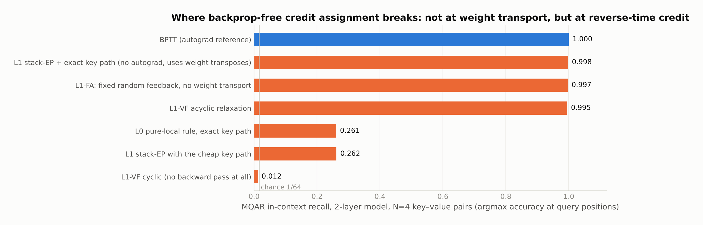
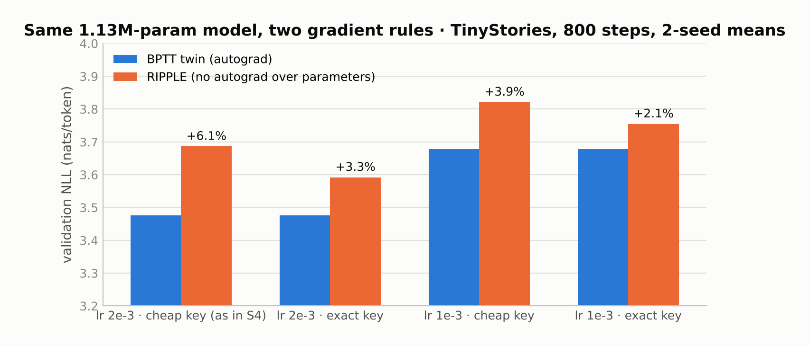

# HDC-LM — backprop-free credit assignment for a gated linear-attention language model: what matched BPTT, and what didn't

Linear attention is already a vector-symbolic sequence model with a learned codebook (Schlag et al. 2021; Katharopoulos et al. 2020). This project asked whether a **local, backprop-free learning rule** can train one. The rule, RIPPLE, combines equilibrium propagation within a block, two-path contrastive-Hebbian codebook updates, exact eligibility traces through the linear recurrence, and a three-factor gate; no reverse-mode autograd runs over model parameters (that constraint is audited by tests). The representation is a bank of complex phasors (FHRR) with binding, bundling, permutation and modern-Hopfield cleanup as the block primitives.

The answers, measured against the *identical* model trained by BPTT at matched data, seed and learning rate:

* **A single-layer model trains to within ~3–4% of its BPTT twin** on TinyStories (val NLL 3.59 vs 3.48), and the first-reported 9% gap turned out to be two fixable gradient approximations, not the rule.
* **Removing weight transport costs essentially nothing** on a 2-layer in-context-recall task (0.997 recall with fixed random feedback vs 0.996–1.000 for BPTT).
* **Removing the reverse-time pass costs everything.** A pure-local rule caps at 0.26 recall; a genuine forward-only space-time relaxation collapses to chance (0.012). Causality, not transport, is the wall.
* **At Pile scale the rule's model was not competitive**: 162M parameters reached val PPL 517 against a 28.9 anchor, at 41–50× lower throughput, and the planned S6 campaign stopped there.



## Results with artifacts

Every number below has a JSON or log in `experiments/` and, for the training runs, `metrics.jsonl` + `summary.json` in `runs/`.

| Question | Result | Artifact |
|---|---|---|
| P1 — is the update a gradient? | RIPPLE's traces match autograd to 1e-8; single-layer RIPPLE-vs-BPTT cosine = 1.0 | `experiments/S3-gradient-fidelity.md`; `tests/test_gradient_fidelity.py`, `test_training_fidelity.py` |
| P2 — RIPPLE vs its BPTT twin, 1 layer, TinyStories BPE-8192, 800 steps, 1.13M params | as first run: 3.779 vs 3.468 (+9.0%). Re-audited with the exact key path and a fixed tied-readout Jacobian: **3.592 vs 3.476 (+3.3%, 2-seed mean)**; +2.1% at lr 1e-3 | `experiments/S4-results-L1.json`, `S8-reaudit-L1-s{0,1}.json`, `S8-reaudit-result.md`; `runs/reaudit_*` |
| 3-layer twin, same protocol | 3.923 vs 3.583 (+9.5%, cheap key path) | `experiments/S4-results-L3.json`; `runs/{ripple,bptt}_L3` |
| 2-layer MQAR recall (N=4, chance 1/64) | L0 pure-local 0.261 · L1 stack-EP 0.998 · L1-FA (no weight transport) 0.997 · L1-VF acyclic 0.995 · L1-VF cyclic (no backward pass) **0.012** · BPTT 1.000 | `experiments/S8-L1-result.md`, `S8-L1FA-result.md`, `S8-L1VF-result.md`, `S8-l1vf-capability.json` |
| Continual learning, 3 Markov domains, 3 seeds | episodic replay cuts forgetting from 8.04 to 1.27 for RIPPLE (BPTT: 7.93 → 1.00); the global scalar gate alone ≈7% | `experiments/S7-continual-result.md`, `S7-continual-results.json` |
| Quality run, 2,500 steps | RIPPLE 3.152 vs BPTT 2.795 val NLL (+12.8%); coherent generated stories | `experiments/S5-results.json`, `S5-run.log` |
| Pile, 162M, frozen-eval protocol | val PPL **517.2** after 400 steps (26M tokens) against a GPT-2-162M anchor at 28.9 under the same frozen evaluation | `experiments/S6-run-B1-lr5e-4.json`, `S6-v0-anchor.json`, `docs/10-s6-protocol.md` |



### The MQAR double dissociation

The in-context-recall experiment (`experiments/mqar_l1.py`, `l1fa.py`, `l1vf_capability.py`) is the clearest result in the repository. Recovering the 2-layer induction head needs **both** inter-block depth credit and the exact key-path gradient: the pure-local rule stays at ~0.26 even with the exact key gradient, and the depth-credit rule stays at 0.26 with the cheap key path. With both, a fully backprop-free rule reaches the ceiling (0.998 = BPTT). Replacing the inter-block weight transpose with fixed random feedback (feedback alignment) still reaches the ceiling at depth 2 and 3 — a transport-free gradient with cosine as low as ~0.04 to the true gradient suffices. But a genuine joint space-time relaxation that also removes the explicit backward sweep injects an O(1) spurious forward coupling and lands at chance; the correct transport-free credit for a causal stack is exactly the acyclic reverse-time structure. For local-learning rules on sequence models, the obstacle is carrying credit backwards in time, not sideways across weights.

### What the Pile result means

The S6 run is the honest ceiling of this programme: at 162M parameters the RIPPLE-trained model reached perplexity 517 where the matched transformer anchor sits at 28.9, and it did so 41–50× more slowly. The frozen-evaluation harness (`docs/10`, `experiments/eval_pile.py`) is sound — our evaluation of the anchor agrees with the reference evaluation to 1.6e-8 — so the gap is the model's, not the protocol's.

## What was built

```
wavenn/          the model: phasor algebra, FHRR memory with Hopfield cleanup, block, RLM (the LM), RIPPLE learning rule (L0/L1/L1-FA/L1-VF), traces, telemetry, generation, Pile data path
experiments/     the S3–S8 experiment scripts and their outputs: result JSONs, run logs, and the write-up for each stage (RESULTS.md is the index)
runs/            metrics.jsonl, summary.json, meta.json and console logs for the training runs (checkpoints not included)
tests/           95 tests: algebra and capacity, exact traces vs autograd, gradient fidelity, stack-EP fidelity, transport-free invariants, space-time EP, generation, resume
docs/            the specification (00–05), the architectural analysis that re-diagnosed the recall failure (07), the space-time EP note (09), the Pile protocol (10), a 2026 weight-transport literature survey (11), and the research whitepaper
```

`docs/00–05` are the design as written before the experiments; `docs/07` and the `experiments/S8-*` write-ups supersede them where they disagree. In particular, "cleanup extends effective context" (P6) was refuted, and the `docs/07` single-cause diagnosis of weak recall was corrected by the S8 factorial.

A follow-on codebase (WNN-2 / EMBER, July–August 2026) rebuilt the model around a gated-delta write and a predictive-coding readout and reported byte-level WikiText-103 numbers. Its run artifacts were not archived, so none of its results are claimed here and its code is not included.

## Reproduce

```bash
pip install torch numpy
python -m pytest tests -q                       # 95 tests, ~10 s on CPU
python experiments/run_s4.py 1 800              # P2: RIPPLE vs BPTT twin, 1 layer
python experiments/reaudit_s4.py 1 800 0        # the re-audit factorial, seed 0
python experiments/mqar_l1.py                   # the 2-layer MQAR factorial
python experiments/l1fa.py                      # transport-free depth credit
python experiments/l1vf_capability.py           # the space-time relaxation capability test
```

The Pile experiments read the NCALM token cache (`wavenn/pile_data.py`, `NCALM_ROOT` environment variable); see the [NCALM repository](https://github.com/Peterpetu/NCALM) for how that cache is built.

## License

MIT.
